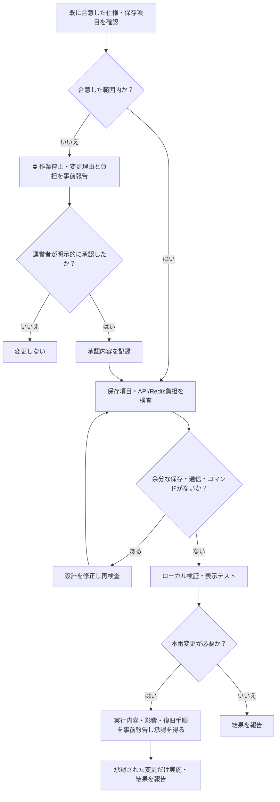
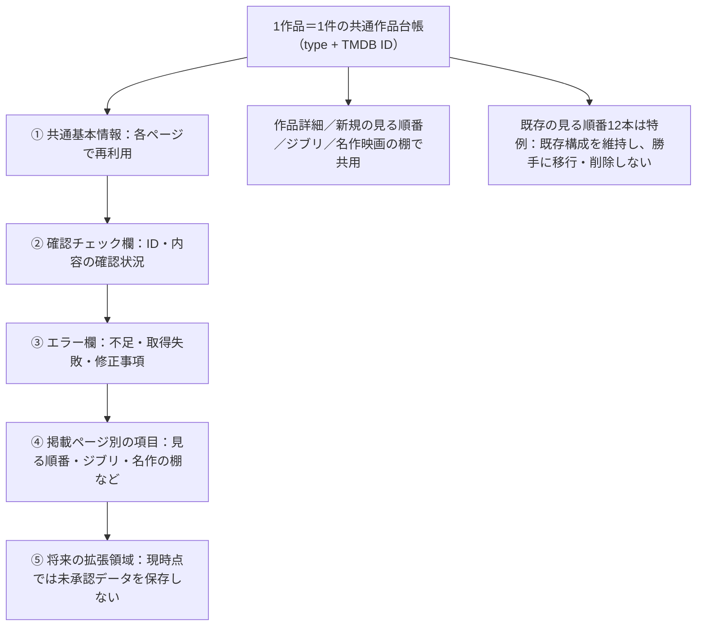
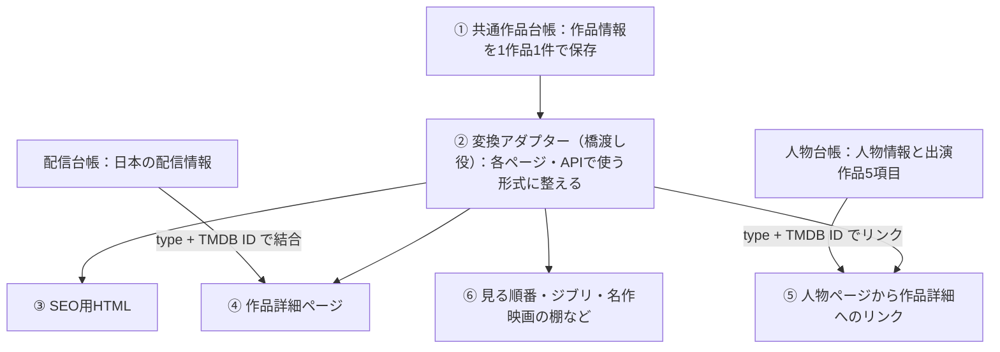

# 開発・保存処理のフローチャート（必須遵守）

> # ⛔ 勝手なことをするな
>
> **合意していない仕様変更・保存項目追加・データ複製・API呼び出し追加・Redis書き込み・削除・デプロイを独断で行わない。**
>
> **変更が必要なら、実行する前に運営者へ「理由・変更箇所・容量/通信/コマンド/費用への影響」を報告し、明示的な合意を得る。**
>
> **「はい」は既に合意した作業を進める意味。新しい仕様や追加コストの承認と解釈しない。**

## 共通作品台帳の確定構造（独断変更禁止）

> **共通作品台帳は1作品につき1件。新しい特集を作るたびに別の作品台帳を増やさない。**
>
> **台帳内の並びは「①共通基本情報 → ②確認チェック欄 → ③エラー欄 → ④掲載ページ別の項目 → ⑤将来の拡張領域」。勝手に削除・分割・統合しない。**
>
> **④と⑤は存在を認めるが、合意していないデータを自由に詰め込む許可ではない。保存する個別項目は事前に合意する。**

- **①共通基本情報**：現在の表示に必要な合意済みの作品情報だけ。監督は1人、主要出演者は最大8人。役名は現在表示していない限り保存しない。声優・キャラクター名などの追加は事前相談。
- **②確認チェック欄**：確認済みか、確認対象と状態を記録する。不要な原本コピーを置かない。
- **③エラー欄**：実際に発生したエラーと必要な修正状況を記録する。無制限の生ログを溜めない。
- **④掲載ページ別の項目**：トリビア、掲載時の一言など、ページ固有で実際に使う項目を**同じ作品レコード内に定義して**管理する。新企画のたびに別作品台帳を作らない。具体的な項目・保存形式は実装前に合意する。
- **⑤将来の拡張領域**：拡張可能な設計は維持するが、未使用データを先回り保存しない。追加は報告・承認後。
- **既存の見る順番12本**：特例として現行の構成・文章・トリビア・並び順を維持。無断移行・削除をしない。
- **人物台帳の出演作品**：作品名・ポスター・公開年・TMDB ID・movie/tvの5項目のみ。人物プロフィール本体とは区別する。
- **配信台帳**：別管理、日本向けの必要情報だけ。6時/18時の既定方針を維持。
- **重要**：従来の `pageExtras`/`commonNotes`/`extensions` を「無条件に廃止して④⑤までなくす」と解釈しない。無制限・未承認データの保存を禁止し、承認済みの④⑤の役割を残す。
- **状態**：これは合意事項を記録した設計図であり、本番コードやRedisを変更したことを意味しない。

## 共通作品台帳から各機能への橋渡し（変換アダプター）

> **覚える名前：変換アダプター（橋渡し役）**
>
> **共通作品台帳 → 変換アダプター → SEO・作品詳細・人物ページ・見る順番・特集。**
>
> 配信情報は別の配信台帳から作品IDで結びつける。人物のプロフィール・出演作品も人物台帳で管理し、共通作品台帳の作品IDへリンクする。

- 変換アダプターは**新しい作品データを大量保存する台帳ではない**。必要な表示形式に整える処理であり、二重保存・余分なAPI呼び出しを増やさない。
- 既存の「見る順番」12本は特例として現行構成を維持し、無断移行しない。
- **新しい台帳に置き換える前に、アダプターが実際の表示を壊さないことを検証する。** コード追加・テスト・本番反映は別々に報告する。

## 作品台帳の保存ルール
- 作品を `type + TMDB ID` で一意管理する。
- **現在合意済みの共通固定情報のみ**保存する。作品ID、movie/tv、作品名、原題、公開日、あらすじ、ポスター、上映時間、ジャンル、評価、監督、主要出演者、シリーズ/シーズン情報。
- 配信情報は別台帳に保存し、既定の日本時間6時/18時の更新方針を変えない。
- `extensions.tmdbDetail` のようなTMDB応答丸ごとの二重保存は禁止。`extensions`/`pageExtras`/`commonNotes` の**無制限な保存**は禁止するが、④掲載ページ別項目・⑤拡張領域の設計上の役割は維持する。
- 追加項目が必要になった場合は、**追加する前に必ず報告・合意**。将来使うかもしれない情報は保存しない。
- 保存前に許可項目だけを抽出する（許可リスト方式）。余分なキーを黙って保存しない。
- 現在の本番Redisは未整理。削除・置換は実行完了と報告するまで「未実施」と明記する。
- 無料枠の容量、コマンド数、API通信、課金への影響を必ず事前に確認する。

## 作業報告のルール
- **コードを追加しただけ**／**テスト合格**／**本番に反映**／**Redisのデータを削除**を区別し、未実施の作業を完了と表現しない。
- 事前合意のない追加作業を理由に、合意済みの作業を繰り返し中断しない。
