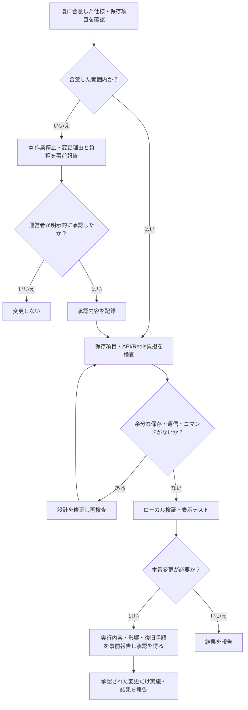

# 開発・保存処理のフローチャート（必須遵守）

> # ⛔ 勝手なことをするな
>
> **合意していない仕様変更・保存項目追加・データ複製・API呼び出し追加・Redis書き込み・削除・デプロイを独断で行わない。**
>
> **変更が必要なら、実行する前に運営者へ「理由・変更箇所・容量/通信/コマンド/費用への影響」を報告し、明示的な合意を得る。**
>
> **「はい」は既に合意した作業を進める意味。新しい仕様や追加コストの承認と解釈しない。**

## 作品台帳の保存ルール
- 作品を `type + TMDB ID` で一意管理する。
- **現在合意済みの共通固定情報のみ**保存する。作品ID、movie/tv、作品名、原題、公開日、あらすじ、ポスター、上映時間、ジャンル、評価、監督、主要出演者、シリーズ/シーズン情報。
- 配信情報は別台帳に保存し、既定の日本時間6時/18時の更新方針を変えない。
- `extensions.tmdbDetail` などTMDB応答丸ごとの二重保存、自由記入の `extensions`/`pageExtras`/`commonNotes` を恒久保存しない。
- 追加項目が必要になった場合は、**追加する前に必ず報告・合意**。将来使うかもしれない情報は保存しない。
- 保存前に許可項目だけを抽出する（許可リスト方式）。余分なキーを黙って保存しない。
- 現在の本番Redisは未整理。削除・置換は実行完了と報告するまで「未実施」と明記する。
- 無料枠の容量、コマンド数、API通信、課金への影響を必ず事前に確認する。

## 作業報告のルール
- **コードを追加しただけ**／**テスト合格**／**本番に反映**／**Redisのデータを削除**を区別し、未実施の作業を完了と表現しない。
- 事前合意のない追加作業を理由に、合意済みの作業を繰り返し中断しない。
